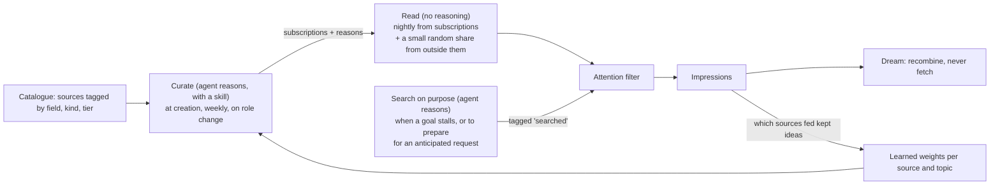

# Intake sources

A catalogue of where a bot's ambient ingestion can come from, by field and by kind of source. A bot's role sets where it starts looking; the kind of source sets how far it is trusted and how its items are fetched. Nothing is hard-wired: the field lists are starting priors, and any source can serve any bot. This is a design for the dreaming loop in [proactivity.md](proactivity.md#ambient-ingestion); none of it is built, and the lab so far has used three fixed feeds for every bot (the repository's commits, Hacker News stories with over 100 points, and Wikipedia's daily feed or arXiv's HCI and neuroscience papers).

Why it matters: in the lab, where references came from mattered more than how many there were. Adjacent-field papers gave an open-ended bot usable references, and a random encyclopedia feed gave forced analogies. Open forums are also where every planted steering item came from.

## Not hard-wired

A source isn't owned by a field. GitHub reads as a coding source, but searched with a designer's terms it turns up design systems, icon sets and Figma plugins; arXiv has papers on fashion recommendation; Reddit has a community for almost anything. So:

- **Sources are tagged, not filed.** Each source carries the fields and kinds it is known for, as hints, and whether it can be searched by query. Many-to-many: one source, several fields.
- **Queries cross fields.** Each night the bot turns its goals and current impressions into a few queries and runs them against every searchable source, not only the ones listed under its fields. The attention filter decides what sticks, wherever it came from.
- **Weights learn per source and topic.** What a source is worth is learned for the topics it actually fed (GitHub for design references, say), not inherited from its usual field, so an unexpected source can earn its place.
- **A small exploration share** goes to sources outside the bot's priors each week, so a source nobody expected can show its value; ranking only by past use would entrench whatever was picked first.

## Who chooses: the agent or the catalogue

Two ways to decide what a bot reads, and the case for each:

1. **The agent reasons over the catalogue each night** (with a skill or rubric on judging sources), searching for what its goals need. Reads are relevant and cheap to justify, and it can reach any source. But it only finds what it already knows to look for: its searches come from its impressions, and its impressions come from its searches, so it narrows into a loop. That is the opposite of what ambient intake is for, which is meeting things nobody went looking for. It also costs a reasoning call per night, and a planted item that steers its queries steers everything after.
2. **Passive feeds from the catalogue with learned weights.** Cheap, and keeps the chance encounters that make dreaming more than retrieval. But it is noisy, most items pass by unused, and a fixed list can't follow a goal that moves.

People do both, at different speeds: they choose their subscriptions now and then, read them without deciding each item, and search on purpose when stuck. So the agent's reasoning goes where it pays, and dreaming stays a consumer of what came in, never a fetcher:

- **Curating** is where the agent reasons over the catalogue: it picks and drops subscriptions with a reason for each, using the learned weights as evidence. The user sees and edits the list.
- **Reading** needs no reasoning beyond the attention filter, and keeps a random share from outside the subscriptions so the loop can't close on itself.
- **Searching on purpose** happens awake, not in the dream: when a goal is stuck (where distant references help, by the published work) or to prepare for something the user is likely to ask. Searched items are tagged as such, so a bot doesn't count what it went looking for as independent evidence.

To test: the same replay with fixed feeds, agent-curated subscriptions, and per-night agent search, compared on whether references shape ideas (by ablation), how a bot's references narrow over weeks, how many planted items stick, and cost.

## How a bot uses it

- **Fields come from the role, as a starting point.** When a bot is created or its role changes, the same one-off call that scores its latitude picks one to three primary fields from the list below and, for bots with exploration to spare, one or two adjacent ones. The user sees and edits the picks on the bot's settings, like the latitude dials.
- **Proximity still applies.** Surroundings (the bot's chats, repositories, calendars, files) come first, then the primary fields as domain reading, then adjacent fields, in the proportions set by the exploration dial.
- **Weights start from a prior and learn.** Each source starts at a weight set by its kind and the bot's dials. It gains weight when its items feed ideas that are kept or suggestions the user accepts, and loses weight when they never do, with a floor so no source drops to zero before it has had a fair run (judged over weeks, not days). A cap per source keeps one loud feed from taking every reference.
- **Trust travels with the item.** Every item carries its source's tier. Open-tier items always go through trust marking, never fill the curiosity slot unchecked, and an idea built on one can only be suggested until a higher-tier source supports it.
- **Each source records what it costs** (calls, tokens, quota) beside what it gave, so a source that costs a lot and feeds nothing is easy to spot.

## Kinds of source

| Kind | What it gives | Default tier | Usual access | Notes |
| --- | --- | --- | --- | --- |
| Papers and preprints | New findings and methods | Primary (peer-reviewed) or curated (preprint) | API | Slow-moving; the best adjacent-field references in the lab |
| Official and primary | Filings, regulations, standards, datasets, advisories, changelogs | Primary | API or feed | Facts to act on; rarely sparks ideas but grounds them |
| News | Reported events | Curated | Feed or API | Daily pulse of a field |
| Newsletters and blogs | Practitioner analysis | Curated | Feed | Good signal per item; choose authors, not platforms |
| Discussion | Forums and communities, what people struggle with | Open | API, feed or search | Where needs show up first; injection-prone |
| Social | Real-time posts | Open | API or search | Fast and noisy; most injection-prone |
| Visual | Images, boards, portfolios | Open or curated | API or search | For design and craft fields; the filter needs a vision model |
| Video and podcasts | Talks, tutorials, interviews | Curated or open | API or feed, transcripts | Read transcripts, never play media |
| Launches and code | New products, releases, repositories | Open or curated | API | What others just shipped |
| Market signals | Prices, prediction markets, search trends, job postings | Primary or open | API | Numbers, not ideas; good for anticipation |
| Events and calls | Conferences, grants, competitions, calls for papers | Curated | Feed or search | Dated opportunities |

Tiers: **primary** is a source of record (a journal, a regulator, an official dataset); **curated** has an editor or author accountable for it; **open** is anyone can post.

## Across all fields

These serve any field, filtered by its terms:

- **Search** through the search interface below, for gaps no listed source covers.
- **News aggregators:** Google News topic feeds, GDELT, The Guardian Open Platform.
- **Papers:** OpenAlex, Semantic Scholar and Crossref cover nearly every discipline; arXiv, bioRxiv, medRxiv, SSRN and OSF Preprints by area.
- **Discussion:** Reddit (a subreddit list per field), Hacker News, Lobsters, Stack Exchange sites, Discord and Slack communities the user is in.
- **Social:** Bluesky and Mastodon (open APIs), X lists (paid API, or search), LinkedIn (through search only).
- **Writing:** Substack and Medium tags, RSS from chosen authors.
- **Video and audio:** YouTube channels and searches (transcripts), podcast feeds.
- **Signals:** Google Trends, Polymarket, Kalshi and Metaculus, Wikipedia's current events portal and page-view trends.

## Fields

Each row lists representative sources by kind, as a starting prior for bots in that field, not a whitelist; a deployment ships a curated subset, the user can add their own, and any source may be searched for any field. Where a source has no usable API, it is reached through search and fetch.

### Technology

| Field | News and writing | Papers and primary | Discussion and social | Launches, signals, events |
| --- | --- | --- | --- | --- |
| Software and developer tools | The Changelog, LWN.net, InfoQ, Pragmatic Engineer | Language and framework release notes, RFCs, IETF Datatracker, W3C drafts | Hacker News, Lobsters, r/programming, language subreddits, Stack Overflow | GitHub trending and releases, npm, PyPI and Go module feeds, conference CFPs |
| AI and machine learning | Import AI, The Batch, lab blogs | arXiv cs.LG, cs.CL, cs.AI; Hugging Face Papers; OpenReview | r/MachineLearning, r/LocalLLaMA, researcher Bluesky and X lists | Hugging Face models and datasets, leaderboards, NeurIPS, ICML and ICLR deadlines |
| Security | Krebs on Security, The Record, Risky Business | NVD, CISA KEV, OSV, vendor advisories, arXiv cs.CR | r/netsec, Full Disclosure, infosec Mastodon | Exploit-DB, CVE feeds, bug bounty programmes |
| Data and analytics | Data Elixir, Locally Optimistic | Dataset releases, Kaggle, arXiv stat.ML | r/datascience, r/dataengineering | dbt and warehouse release notes, Kaggle competitions |
| Infrastructure and operations | SRE Weekly, cloud provider blogs | Cloud status pages and changelogs, Kubernetes enhancement proposals | r/devops, r/sysadmin, r/kubernetes | Incident write-ups, KubeCon and SREcon |
| Hardware, electronics and making | Hackaday, IEEE Spectrum, CNX Software | Datasheets, arXiv eess, chip vendor notes | r/electronics, r/embedded, EEVblog forum | Crowd Supply, Kickstarter tech, Tindie |
| Robotics | The Robot Report, IEEE Spectrum Robotics | arXiv cs.RO, ICRA and RSS proceedings | r/robotics, ROS Discourse | ROS releases, competitions |
| Crypto and web3 | The Block, Bankless | Protocol improvement proposals, audits, Ethereum research forum | r/ethereum, crypto X lists | CoinGecko, DefiLlama, on-chain explorers |

### Science and research

| Field | News and writing | Papers and primary | Discussion and social | Signals, events |
| --- | --- | --- | --- | --- |
| Physics and astronomy | Quanta, Physics World, Universe Today | arXiv physics and astro-ph, NASA ADS | r/Physics, r/Astronomy | NASA APIs, telescope and mission news, conference listings |
| Chemistry and materials | Chemistry World, C&EN | ChemRxiv, ACS and RSC tables of contents | r/chemistry, r/materials | Materials Project data releases |
| Biology and life sciences | The Scientist, STAT (biotech) | bioRxiv, PubMed, Europe PMC | r/biology, scientist Bluesky | Database releases (UniProt, PDB), grants |
| Earth, climate and environment | Carbon Brief, Inside Climate News | NOAA, NASA Earthdata, Copernicus, IPCC reports | r/climate, r/geology | Emissions and weather data, COP calendar |
| Mathematics and statistics | Quanta, Terence Tao's blog | arXiv math and stat | MathOverflow, r/math | Competitions, conference calls |
| Psychology and neuroscience | The Transmitter, Psychology Today research | PsyArXiv, arXiv q-bio.NC, PubMed | r/neuroscience, r/AcademicPsychology | Replication project updates, conferences |
| Social sciences | The Conversation, Works in Progress | SSRN, SocArXiv, NBER working papers | r/AskSocialScience | Survey data releases (Pew, World Values) |
| Humanities (history, philosophy, languages) | Aeon, Psyche, JSTOR Daily | PhilPapers, Humanities Commons | r/AskHistorians, r/philosophy | Archive and digitisation releases |
| Research careers and funding | Nature Careers, Times Higher Education | Grants.gov, NIH RePORTER, NSF awards, national research councils | r/AskAcademia, r/PhD | WikiCFP, funder deadlines |

### Health

| Field | News and writing | Papers and primary | Discussion and social | Signals, events |
| --- | --- | --- | --- | --- |
| Medicine and health care | STAT, Medscape, BMJ news | PubMed, ClinicalTrials.gov, medRxiv, Cochrane | r/medicine (professionals), clinician Bluesky | openFDA, WHO GHO, drug approvals |
| Public health | CIDRAP, Our World in Data | WHO, CDC and national health agency data | Epidemiologist Bluesky | Outbreak and surveillance feeds |
| Fitness, nutrition and wellbeing | Examine, Stronger by Science | PubMed (sports science, nutrition) | r/fitness, r/nutrition, r/running | Wearable trend reports, events |
| Mental health | Mind, NIMH news | PsyArXiv, PubMed | r/mentalhealth (sensitive, read-only) | Service and policy changes |

### Business and money

| Field | News and writing | Papers and primary | Discussion and social | Launches, signals, events |
| --- | --- | --- | --- | --- |
| Startups and entrepreneurship | TechCrunch, Lenny's Newsletter, Stratechery | Y Combinator library, Crunchbase news, startup post-mortems | Hacker News, r/startups, r/Entrepreneur, Indie Hackers, founder X lists | Product Hunt, YC batches, Hacker News "Show HN", accelerator deadlines |
| Business, management and operations | HBR, McKinsey Insights, The Economist business | Company filings (SEC EDGAR, national registries), earnings calls | r/smallbusiness, r/managers, LinkedIn (search) | Earnings calendars |
| Product management | Lenny's Newsletter, Mind the Product | Competitor changelogs and help centres | r/ProductManagement | App store rankings and reviews |
| Marketing, growth and sales | Marketing Brew, Growth.Design | Platform policy and ad-product changes | r/marketing, r/SEO, r/sales | Google Trends, SEO tool updates |
| E-commerce and retail | Modern Retail, Marketplace Pulse | Marketplace seller policy changes | r/ecommerce, r/EtsySellers, r/shopify | Marketplace trend reports, seasonal calendars |
| Finance and investing | Bloomberg, FT, Matt Levine | SEC EDGAR, central bank releases, FRED | r/investing, r/SecurityAnalysis | Market data, prediction markets |
| Personal finance | Money columns, The Penny Hoarder | Tax office and regulator guidance, bank rate tables | r/personalfinance, national subreddits (r/AusFinance) | Interest rates, price indexes |
| Economics and policy | Marginal Revolution, Noahpinion, Bruegel | NBER, IMF, World Bank, OECD data, central bank research | Economist Bluesky, r/AskEconomics | Statistics release calendars |
| Supply chain, logistics and manufacturing | Supply Chain Dive, FreightWaves | Trade data (UN Comtrade), freight indexes | r/supplychain, r/manufacturing | Port and freight rates |
| Real estate and property | Property news sites, The Real Deal | Land and planning registries, rate releases | r/RealEstate, local property subreddits | Listing portals' APIs where offered (Domain), auction results |
| Careers, HR and recruiting | HR Dive, Josh Bersin | Employment law updates, labour statistics | r/recruitinghell, r/humanresources, r/cscareerquestions | Job boards (Greenhouse and Lever public boards, HN "Who's hiring") |
| Nonprofit and social impact | Chronicle of Philanthropy, Devex | Grant databases, charity registries | r/nonprofit | Funding calls |

### Law and public life

| Field | News and writing | Papers and primary | Discussion and social | Signals, events |
| --- | --- | --- | --- | --- |
| Law and regulation | Law360, Lawfare, legal blogs | Federal Register, regulations.gov, EUR-Lex, legislation.gov.uk, CourtListener | r/law, r/legaladvice (read-only) | Comment deadlines, court calendars |
| Government and civic | Government news releases, Apolitical | Parliamentary records and bills, open data portals | Local civic forums | Consultation deadlines, elections |
| Journalism and world news | Reuters, AP, BBC, national broadcasters | Wire feeds, press releases | r/worldnews, journalist Bluesky lists | GDELT event trends |
| Local and community | Local news outlets | Council agendas and minutes, planning applications | City and suburb subreddits, community groups | Eventbrite, Meetup, council events |
| Education and learning | EdSurge, The Hechinger Report | ERIC, education department releases | r/Teachers, r/education | Course and term calendars |

### Design and creative

| Field | News and writing | Visual and references | Discussion and social | Launches, events |
| --- | --- | --- | --- | --- |
| UX, UI and product design | Nielsen Norman Group, Smashing Magazine, UX Collective | Mobbin, Dribbble, Figma Community, Refactoring UI, GitHub (design systems, icon sets, Figma plugins) | r/UXDesign, r/userexperience, designer Bluesky and X lists | Design system releases, Config and other conferences |
| Graphic design, illustration and visual art | It's Nice That, Creative Bloq | Pinterest boards, Behance, Are.na, ArtStation | r/graphic_design, r/Illustration | Competitions, open calls |
| Architecture and interiors | Dezeen, ArchDaily | Pinterest, Are.na, project publications | r/architecture, r/InteriorDesign | Competitions, planning approvals |
| Fashion and beauty | Business of Fashion, Vogue Business | Pinterest, Instagram (search), runway archives | r/femalefashionadvice, r/malefashionadvice, r/SkincareAddiction | Fashion week calendars, trend reports |
| Photography and video production | PetaPixel, No Film School | Unsplash, Flickr groups | r/photography, r/videography | Gear releases, festivals |
| Music and audio | Pitchfork, Music Business Worldwide | Spotify and MusicBrainz data, Bandcamp | r/WeAreTheMusicMakers, r/musicproduction | Release calendars, charts |
| Film, TV and entertainment | Variety, Deadline | TMDB, IMDb datasets, box office data | r/movies, r/Screenwriting | Festival and awards calendars |
| Writing and publishing | Publishers Weekly, Jane Friedman | Open Library, agent and magazine submission listings | r/writing, r/fantasywriters, writer Bluesky | Submission calls, contests |
| Games and game development | Game Developer, Rock Paper Shotgun | Steam data, GDC Vault talks | r/gamedev, r/IndieDev | Steam releases, itch.io jams, game jams |
| Crafts, making and hobbies | Craft blogs, Make: | Pinterest, Ravelry (fibre crafts) | Craft subreddits (r/Pottery, r/woodworking) | Markets and fairs |

### Everyday life

| Field | News and writing | Primary and references | Discussion and social | Signals, events |
| --- | --- | --- | --- | --- |
| Food and cooking | Serious Eats, Bon Appétit | Recipe sites, food safety agencies | r/Cooking, r/AskCulinary | Seasonal produce, restaurant openings |
| Travel and hospitality | Skift, The Points Guy | Government travel advisories (Smartraveller, State Department), airline and airport notices | r/travel, r/solotravel, r/awardtravel | Fare alerts, events at the destination |
| Home, family and parenting | Wirecutter, parenting columns | Product recall databases, school notices | r/Parenting, r/HomeImprovement | Recalls, school calendars |
| Sports | ESPN, The Athletic | League and federation data, fixtures | Team and sport subreddits | Fixtures, results, transfers |
| Automotive and transport | Electrek, Car and Driver | Recall databases, transport authority notices | r/cars, r/electricvehicles | Fuel and charging prices, transit alerts |
| Climate action and energy at home | Canary Media, RenewEconomy | Energy regulator and market data, rebate programmes | r/solar, r/energy | Electricity prices, rebate deadlines |
| Agriculture and gardening | Successful Farming, gardening columns | USDA and FAO data, weather services | r/farming, r/gardening | Planting calendars, weather alerts |
| Religion, spirituality and philosophy of life | Faith and ethics publications | Texts and commentaries | Community forums | Religious calendars |

## Fetching: three swappable interfaces

Every piece of the intake sits behind a small interface so implementations can be swapped without touching the loop:

- **Source** returns items since a time: an ID, title, text, URL, date, kind and tier. One implementation per API or feed; a generic RSS and Atom one covers most news and blogs.
- **Searcher** answers a query with results. Implementations wrap free and self-hosted search: a self-hosted SearXNG instance (open-source metasearch, no quota) as the default, and hosted APIs (Tavily, Exa, Brave Search and others) on their free tiers. A rotating searcher tries them in order, tracks each one's remaining quota and rate limits, skips one that has run out until its quota resets, and caches results so a repeated query costs nothing.
- **Fetcher** turns a URL into clean text. Implementations: a plain HTTP fetch with readability-style extraction, a self-hosted Firecrawl for pages that need a browser, and a reader API as a fallback. It honours robots.txt, each site's terms and rate limits, and never plays media.

The `last30days` skill's source adapters (Reddit, X, YouTube, Hacker News, Polymarket, GitHub, the web) are a working example of this shape and can seed the first Source implementations.

## Open questions

1. How many starting fields per bot: one to three primary and up to two adjacent, or set by the exploration dial alone?
2. Does a source's weight learn per bot, or across all of the user's bots in the same field?
3. Which visual sources can be read within their terms, and does the filter need a vision model for them?
4. Who maintains the catalogue: shipped and updated with Polymux, edited per user, or both?
5. Should sources the user already reads (their newsletter subscriptions, followed accounts) be preferred over the catalogue's defaults?

## Next experiment

Replay the same days with sources picked from the catalogue for each bot's role, against today's fixed feeds, on several roles beyond software (a researcher, a founder, a designer), and compare which references get used, how often citations are decorative, and how many planted items stick from open-tier sources.
