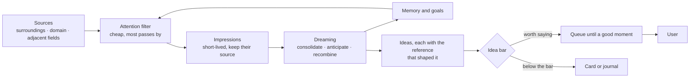

# Proactive behaviour

North star: lift cognitive load off the user. Every message costs attention, so it has to save more than it spends.

Design direction, not current implementation. Built today: the messaging behaviour ([Chat style](chat-style.md)), routines, reminders and content watches. The rest of this page is design. Dreaming, ambient ingestion, the attention filter and latitude scoring are being tried on the `experimental/dreaming` branch ([Experiments](experiments.md)); what that showed is under [Experiments so far](#experiments-so-far), and the published work it was checked against under [Prior work](#prior-work).

## Levels

A hierarchical, systematic architecture: the same move as hierarchical memory (MemGPT-style tiers). Each level has its own timescale and its own process.

- **Role / purpose** (months, open-ended): the bot's mandate, given or deduced from conversation. Latitude matches position: a junior gets a clear goal, someone senior gets an open-ended one (see [Latitude](#latitude-two-dials)).
- **Goals** (days to weeks), two kinds, with subgoals under them:
  - *Conditional*: clear completion conditions; split into stages, achieve. Afterwards "what's next?" stays tied to user intent, so the bot doesn't go haywire.
  - *Non-conditional* (open-ended, such as "improve company performance"): no completion condition; needs creativity and initiative.
- **Stages** (hours to days): the rhythm of work blocks that advance the current stage. Keeps alignment with the goal and stops sidetracking and over-investing in one thing.
- **Intentions** (minutes to hours): cue, then action, from a verified source. Prospective memory: "when X happens, do Y", fires on the cue, closes when met.
- **Schedules**: for the model to remind itself of things. Each carries its purpose and an end point, and pauses itself when the purpose is met, it keeps failing, or nobody engages. No stale schedules.
- **Passive awareness** (continuous): cheap matching of events to intentions and goals, which gives recall ("oh, I need to..."). After something relevant sticks, the bot asks once whether it changes what it would do for a goal, and may form an intention from the answer; agents otherwise notice information and then don't use it.
- **Active focus**: the live conversation, with full attention, on topic. When the user isn't talking, the bot still does things on its own initiative, as a person does.

## One loop, not separate systems

Memory, ingestion, awareness and creativity don't separate cleanly; they are one loop. The levels above decide what counts as salient, and the [latitude dials](#latitude-two-dials) decide how much of the loop a bot runs.

How the result is *said* stays a separate system: [Chat style](chat-style.md) governs only what the user reads.

## Latitude: two dials

How much a bot does on its own depends on its job. Two separate dials, because they cost different things:

- **Initiative**: how much it speaks up or acts without being asked, because its job is to watch over something. It costs the user's attention. An on-call engineer or an inbox manager is high.
- **Exploration**: how much the job depends on ideas nobody specified. It costs compute. An on-call engineer is low; a growth lead or a research partner is high.

| | Low | Middle | High |
| --- | --- | --- | --- |
| **Initiative** | Only what was asked, plus due reminders | Conflicts and things it notices | Proposals and hypotheses too, within a weekly message budget |
| **Exploration**: ingestion | Its own work | Plus its surroundings | Plus its domain and adjacent fields, with the curiosity slot |
| **Exploration**: dreaming | Consolidation after active days | Plus anticipation and linking impressions to goals | Plus recombination into ideas |
| **Exploration**: budget | Near zero | Small | A larger share of the bot's spend |

- **Scored from the role.** A decision model rates both dials when a bot is created and again when its role, instructions or goals change, or the purpose it deduced shifts. A blank role (the default bot) gets a set default, not a score.
- **A starting point, not a setting.** The right level of initiative differs per user and moves with trust, so outcomes move each dial within a range around its starting value: ideas acted on raise exploration, dismissals made at a natural break lower initiative. A slider in the bot's settings shows each value and why, and the user can set it.
- **Consolidation runs for every bot** after a day with activity; it is what makes even a narrow bot cheaper and faster over time.
- **Until a small model is trained**, one cheap model call with a fixed prompt does the scoring; it runs only at creation and on role changes.

## Ambient ingestion

People take in information without deciding to: reading the news, walking around, overhearing. A bot with exploration to spare should too, instead of only keeping what it chooses to save from chat.

- **Sources, by proximity.** Most comes from the bot's surroundings (its chats, its repos, issues and CI, its own work). Some comes from its domain, as a person reads news. A little comes from adjacent fields outside it: papers in human-computer interaction or neuroscience for a bot that builds an assistant, not a random encyclopedia page. There is no right ratio; each source is judged over weeks by how often what it gave went on to shape an idea that was used, and sources that never pay drop out.
- **An attention filter decides what sticks.** Everything is skimmed cheaply against the bot's purpose, goals and current impressions; only what is salient becomes an impression, and most items pass by. The target is a small decision model trained on the main model's labels as corrected by the user's reactions, with uncertain items sent to the main model.
- **A curiosity slot.** Judged only on relevance, nothing outside the goals ever sticks. So each goal carries one to three open questions, and the filter also scores how much an item would change one of them. Each day the slot may keep the most surprising such item from a source where nothing relevant stuck, and stays empty on a day with nothing strong. Oddness alone doesn't qualify.
- **Impressions are short-lived.** Each keeps its source and date, a strength that fades with time since it was last touched (a power law, with spaced touches counting more than bursts), and links to the goals and impressions it relates to. One touched often or used in an idea that was acted on is promoted into memory; the rest fade, keeping only a pointer to where they came from.

## References and ideas

Creativity often comes from references that spark ideas, but the experiments and the published work agree that this is conditional, not automatic.

- **Near references by default.** Dreaming puts a goal next to the bot's strongest related impressions. A distant reference is used when a goal is stuck, and then by mechanism, not topic: what the thing does, and what the equivalent would be here.
- **Most cited references are decoration**: the idea would be the same without them. So whether a reference shaped an idea is checked by ablation, regenerating the idea without it, not by asking the model. Reference order is shuffled each night, since the first-listed source takes a large share of the credit.
- **Habituation and exploration.** An impression that has fed several ideas weighs less in the next dream, and one or two reference slots per deep dream go to impressions sampled at random, so ones that never surfaced can still show their value. Ranking by use alone entrenches whatever surfaced first.
- **The idea bar ranks a night's ideas in one pass, and may pick none.** It scores usefulness, originality and feasibility separately rather than one combined number, since a single "attention saved" score favours safe chores. Fixed thresholds on model scores proved brittle.
- **Diversity is tracked per bot.** A bot's ideas narrow over weeks; when its diversity drops, its source mix changes.

## Dreaming

Dreaming uses time the user isn't using. It has two depths, like sleep stages, and how much of it a bot does follows its exploration dial.

- **When.** A nap starts once the bot has been idle, with no user message, no running work and nothing queued, for a while. A deep dream runs when enough new material has stuck since the last one, at most once in about 20 hours, and at least daily at the user's quietest hour if the bot was active; nothing new means no dream. Starting values to tune: 45 to 60 minutes idle, about 20 hours apart, 3am local as the default quiet hour.
- **Light (naps).** Cheap, read-only, interruptible: ingest new items, run the attention filter, link impressions to goals.
- **Deep.** Three outputs, by exploration level:
  - *Consolidation*, for every bot (below).
  - *Anticipation*: from the current stages and intentions, predict the user's likely next requests and prepare for them. Judged by whether they came and how much time it saved, which is easier to measure than ideas.
  - *Recombination* into ideas, for bots with high exploration.
- **Never at the cost of productivity.** A message wakes the bot: a dream pauses at its next step boundary and resumes later. A write in progress finishes first. Dreaming is lowest priority on the model allowance and skips when allowance is low.

### Consolidation

Follows [Agent Swarm's dreaming](https://www.agent-swarm.dev/blog/our-agents-dream-every-night), with guards from the memory literature:

- The model proposes; scripts and gates decide. Each bot reports proposals with evidence; a reviewer approves with a reason for every rejection; reject by default, with caps per night.
- Guarded, reversible writes: exact-match edits, a pre-image before each write, a re-read after, a ledger to roll back from. A cut whose text comes back is pinned.
- Source and date are kept verbatim on every promoted memory, enforced in code; consolidation otherwise drops them. The raw trace stays as an immutable record beneath the consolidated memory, and a superseded fact is marked with when it stopped being true rather than deleted.
- Recall is probed before and after each deep dream, and the night's writes roll back if it drops.
- Ideas, hypotheses and recombinations are never written back as facts.
- Memory is credited by outcomes (an idea acted on, a reminder used), not by how often it was retrieved.

## Delivery: worth saying, and worth saying now

Timing fails separately from content: models left to choose speak too early about half the time.

- An idea past the bar goes into a queue with a deadline set by its urgency, and is delivered at the next natural break before then (the user opening that bot's chat, finishing a block of work, or the morning card), never in the middle of something else and never right after a rejection.
- Beside the decoration check, a "why now" check: what does this unlock for the user now, and why can't it wait for the card?
- A weekly budget of unprompted messages per bot, set by its initiative dial.
- Silence is the default, and the bench gets cases where staying quiet is the only right answer.

## Judging it: observe, don't benchmark

- **The user's reactions decide.** Model judges of ideas are near chance and favour feasible over original, and ideas that read well often lose their edge once carried out. Model rankings are drafts; once there are enough reactions, a small judge trained on them replaces the prompt.
- **Trace everything,** including what the user was doing when something arrived. A dismissal while switching tasks isn't a verdict on the idea; only reactions at a natural break count against it.
- **Look back regularly** with the user, weekly at first, and judge exploration over months: short windows under-read it.
- **The bench is a guard only**: more initiative must not mean more noise or unapproved actions.
- **Built to be judged.** Each part can be switched off on its own, and gets a review date when it is turned on.

## Confidence

| Part | Status |
| --- | --- |
| Consolidation loop, propose-only reports, reject by default, guarded reversible writes | Proven elsewhere (Agent Swarm) |
| Delivery at natural breaks, a message budget, silence as default | Supported by published work |
| Two latitude dials scored from the role | Experimental; scoring was stable and caught role drift |
| Ambient ingestion, attention filter, fading impressions | Experimental; behaved believably in replay |
| References shaping ideas | Experimental; no measured lift yet, and references matter more for open-ended bots |
| One-pass ranking, habituation, anticipation | Experimental; ranking and habituation looked better in replay, anticipation untried |

## Open questions

1. Idle threshold: a fixed 45 to 60 minutes, or scaled to how quickly the user usually replies to that bot?
2. Each bot dreams on its own idle time (capped at a couple at once), or all bots together?
3. Should dreaming be visible, as a status on the avatar or in the chat list?
4. Who approves consolidation proposals without a lead bot: a second pass by the same bot, a chief bot, or the user through a morning card?
5. Auto-apply within caps, or wait for the user's approval?
6. Which sources first, and what starting mix of surroundings, domain and adjacent fields?
7. Should the user's own expertise in a bot's domain lower its initiative, as some studies suggest?

## Prior work

The design was checked against published work in four areas. The full reviews, about 90 sources with what each found, are kept with the experiment's results on `experimental/dreaming`.

- **When to speak.** Timing fails on its own: one benchmark fell from 96 to 38 when the model picked its own moment, and models chimed in too early 46% of the time. Frontier models asked to decide fire on almost everything; a small trained gate beat them. Preferred initiative is low to medium, differs per user and follows trust. (Iqbal and Bailey on breakpoints; Horvitz on mixed initiative; ProactiveBench; PITCH; MemoProAgent; Kraus.)
- **Memory and consolidation.** Offline consolidation saves size and cost more than it adds quality, and drops dates and sources unless told not to. Ranking memory by use can't see the value of memories never retrieved. Preparing for predictable next requests during idle time pays off. (Letta sleep-time compute; Generative Agents; ExpeL; Discovery by Dreaming, where recombination only matched a retrieval baseline and a same-family judge rated nearly every connection genuine.)
- **Ideas and references.** Ideas that read as more novel lost 1.0 to 1.9 points once experts carried them out; model judges agree with experts barely above chance. Far references help only at an impasse and by structure; random distance gives no average lift. The first-listed source takes 22 to 35% of the credit. (Si et al.; Chan; Liu et al.)
- **Attention and curiosity.** Novelty alone loses to novelty plus relevance plus timeliness; memory need decays as a power law; agents notice relevant information far more often than they use it. Nothing found shows off-goal intake improving an agent's work; the benefits measured are on people, over long horizons. (Anderson and Schooler; Chen; OMNI.)

## Experiments so far

`experimental/dreaming` replays past days of this repository (its dreamlab command, whose README holds the full results) and scores bot roles for latitude (its latitudelab command). One model, DeepSeek v4.1 Flash, does every step, including judging, so the filter and the judge are stand-ins. The replay doesn't exercise the inactivity trigger, waking on a message, allowance priority or delivery timing.

### First run, 18 November 2026

The bot's purpose and goals come from the repository as it stood on 31 October. Each evening it skims that day's commits (surroundings), Hacker News stories over 100 points (domain) and an outside source; each morning it dreams. 31 October to 11 November, four rounds, two reps per arm, about 600 model calls and $0.90.

- **The filter and fading behave believably.** About one commit in ten sticks and two to seven of about 285 news stories; untouched impressions fade in about four days and touched ones are promoted.
- **The goals-only control scored best on the bar.** It put 7 ideas past the bar and 82 on the card, more than any arm with references (1 to 6 past the bar, 12 to 21 on the card). The decoration check doesn't apply to it, so the counts aren't like for like. Read side by side, its ideas are predictable engineering chores (a module-boundary canary, a search ablation harness) and the reference arms' are fewer but more specific, but that is a reading, not a measurement: a blind sample of both is in the branch's results for judging.
- **Adjacent oddities gave the most distinctive ideas.** The curiosity slot's picks were striking stories next to the bot's field: residential proxies found on the White House network became per-tool network egress checks for MCP servers; a fake-job-interview heist became an adversarial install test for bot-installed tools; lawyers sanctioned for prompt injection became trust labels on tool output before it reaches memory. In numbers, ideas citing those picks were shaped by them about as often as ideas citing anything else (23% against 22 to 31%), so this is what the ideas read like, not a measured lift.
- **Random outside references are forced.** Wikipedia's daily feed rarely struck the filter (median 0.15) and gave forced analogies. Of ideas citing papers in human-computer interaction and neuroscience, 15 of 49 were shaped by them, against 3 of 21 for Wikipedia; that round also added idea memory, and none of those ideas passed the bar. One example: "Do agents need to sleep?" led to a memory consolidation pass.
- **Most cited references are decoration** (70 to 78% in every variant), so the decoration check stays.
- **Fixed thresholds on the bar's scores are brittle.** It turned down ideas at 0.58 novelty that read better than ones it kept.
- **One impression feeds most nights.** The commit that let bots set up their own skills and MCP servers was cited on 8 to 10 of 12 nights. The ideas themselves rarely repeated (0 to 9% near-duplicates of an earlier night's); the many MCP ideas came from a goal that names MCP, not from fixation.
- **Checking ideas against later commits told us nothing**: no arm, and no control window, had an idea a later commit realised. Reading the journal is what showed the above.

### Second run: latitude, 18 November 2026

**Scoring roles.** 32 roles (the bench's specialist bots, the default bot, narrow, operational and open-ended jobs, mismatched wording, paraphrases and role edits), three times each.

- A single 0 to 1 score was stable and ignored wording (a "Visionary Chief Innovation Officer" renaming PDFs scored 0.03), but squeezed ongoing duties into the low band (inbox manager 0.22, on-call 0.17).
- A four-part rubric spread them, but put inbox, home and on-call bots in the high band: it rated judgement inside a known job as needing new ideas.
- Two separate scores, initiative and exploration, split them cleanly: on-call 0.85 and 0.17, inbox 0.85 and 0.19, research partner 0.70 and 0.93, writing partner 0.45 and 0.90. Paraphrases moved a score by at most 0.03, and all four role edits crossed a band (a receipts bot told to also find ways to cut spending went from 0.05 to 0.68 exploration). A blank role scored 0 on both, hence a set default.

**Dreaming by latitude.** Narrow, operational and open-ended bots derived from the same 31 October snapshot (scored 0.10, 0.30 and 0.90), each run goals-only, with references, and with references plus habituation, two reps each, about $1.40.

- **References matter more as latitude rises.** The share of cited references that were decoration was 93% for the narrow bot, 82% for the operational one and 62% for the open-ended one. The narrow bot's ingestion and references produced nothing past the bar: spend with no return. One profile per level, so a pattern, not a trend.
- **A model judge still preferred goals-only ideas** in every profile (open-ended: 20 against 12, with 10 tied, comparing each arm's best idea per night and goal in both orders). Given what the literature says about model judges, this shows they won't find references' value, not that there is none.
- **Habituation did its job without changing quality.** It cut the most-reused reference from 7 to 9 nights to 4 or 5 and raised the number of distinct references; the judge split 11 against 10.
- **Ranking a night in one pass beat the top combined score**: where they disagreed, the one-pass pick won 5 against 1, and it chose none on 4 of 23 nights for the open-ended bot and 7 of 8 for the operational one. Small numbers.

Next: anticipation as a dream output, the ablation decoration check with shuffled reference order and a shuffled-reference control, open questions per goal for the curiosity slot, a stronger model for the deep dream than for the filter, at least three reps, and the user's own ratings: a blind sample is in the branch's results.
