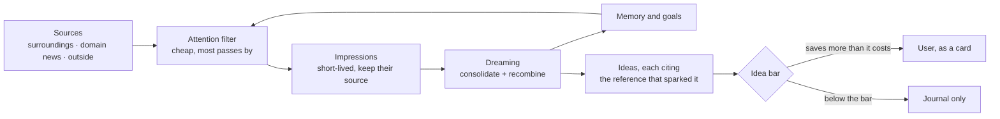

# Proactive behaviour

North star: lift cognitive load off the user. Every message costs attention, so it has to save more than it spends.

Design direction, not current implementation. Built today: the messaging behaviour ([Chat style](chat-style.md)), routines, reminders and content watches. The rest of this page is design. Dreaming, ambient ingestion and the attention filter are being tried on the `experimental/dreaming` branch ([Experiments](experiments.md)); what that showed is under [Experiment](#experiment).

## Levels

A hierarchical, systematic architecture: the same move as hierarchical memory (MemGPT-style tiers). Each level has its own timescale and its own process.

- **Role / purpose** (months, open-ended): the bot's mandate, given or deduced from conversation. Latitude matches position: a junior gets a clear goal, someone senior gets an open-ended one.
- **Goals** (days to weeks), two kinds, with subgoals under them:
  - *Conditional*: clear completion conditions; split into stages, achieve. Afterwards "what's next?" stays tied to user intent, so the bot doesn't go haywire.
  - *Non-conditional* (open-ended, such as "improve company performance"): no completion condition; needs creativity and initiative.
- **Stages** (hours to days): the rhythm of work blocks that advance the current stage. Keeps alignment with the goal and stops sidetracking and over-investing in one thing.
- **Intentions** (minutes to hours): cue, then action, from a verified source. Prospective memory: "when X happens, do Y", fires on the cue, closes when met.
- **Schedules**: for the model to remind itself of things. Each carries its purpose and an end point, and pauses itself when the purpose is met, it keeps failing, or nobody engages. No stale schedules.
- **Passive awareness** (continuous): cheap matching of events to intentions and goals, which gives recall ("oh, I need to..."). An observer of the overall situation, distinct from active focus.
- **Active focus**: the live conversation, with full attention, on topic. When the user isn't talking, the bot still does things on its own initiative, as a person does.

## One loop, not separate systems

Memory, ingestion, awareness and creativity don't separate cleanly; they are one loop. The levels above decide what counts as salient, so a bot with a clear goal notices different things than one with an open-ended purpose.

How the result is *said* stays a separate system: [Chat style](chat-style.md) governs only what the user reads.

## Ambient ingestion

People take in information without deciding to: reading the news, walking around, overhearing. A bot should too, instead of only keeping what it chooses to save from chat.

- **Sources, by proximity.** Most comes from the bot's surroundings (its chats, its repos, issues and CI, its own work). Some comes from its domain, as a person reads news. A little comes from adjacent fields outside its domain, which is where unexpected references come from: papers in human-computer interaction or neuroscience for a bot that builds an assistant, not a random encyclopedia page (see [Experiment](#experiment)). There is no right ratio; start with a loose mix and tune it by observing what sticks and what sparks ideas.
- **An attention filter decides what sticks.** Everything is skimmed cheaply against the bot's purpose, goals and current impressions; only what is salient or new becomes an impression. Most items pass by. The target is a small decision model like the one the [speech review gate](speech.md) uses, not the bot's main model.
- **A curiosity slot.** Judged only on relevance, nothing outside the bot's goals ever sticks. So the filter also scores how striking an item is, and each day keeps the single most striking item from a source where nothing relevant stuck, the way a person remembers an odd story.
- **Impressions are short-lived.** Each keeps its source, so it can be cited as a reference, a strength that fades with time, and links to the goals and impressions it relates to. An impression that new items keep touching is reinforced; one touched often or used in an idea is promoted into memory. The rest fade, as most of what a person sees does.

## References and creativity

Creativity usually comes from references that spark ideas: hypothesising something that may be ridiculous but is still worth trying.

- Dreaming puts a current goal next to references, both close ones and deliberately distant ones, and asks what follows. For a distant reference it borrows the mechanism, not the topic: what the thing does, and what the equivalent would be for this goal.
- Every idea names the reference that sparked it, so the user can always see why the bot thought of it.
- Most cited references are decoration: the idea would be the same without them. Before the idea bar, a check asks exactly that, and an idea whose references are decoration doesn't count as sparked.
- An idea reaches the user only past the idea bar: it has to save more attention than it costs. Ideas worth reading but not worth an interruption go on the card; everything else stays in the journal. Rank a night's ideas against each other rather than against fixed score thresholds, which the experiment found brittle.
- Dreams fixate: a strong impression keeps coming back night after night. An impression that has already fed several ideas should weigh less in the next dream, as a person habituates.

## Dreaming

Dreaming uses time the user isn't using. It has two depths, like sleep stages.

- **When.** A nap starts once the bot has been idle, with no user message, no running work and nothing queued, for a while. A deep dream needs a long quiet stretch and runs at most once in about 20 hours; if a day passes without one, it runs anyway at the user's quietest hour, learned from their activity. Starting values to tune, not decisions: 45 to 60 minutes idle, about 20 hours between deep dreams, 3am local as the default quiet hour.
- **Light (naps).** Cheap, read-only, interruptible: ingest new items from the bot's sources, run the attention filter, link impressions to goals.
- **Deep (once a day).** Consolidation (propose, approve, apply, verify: see below) and recombination (ideas from goals and references).
- **Never at the cost of productivity.** A message wakes the bot: a dream pauses at its next step boundary and resumes later, since every step records its state. A write in progress finishes first, so no edit is left half done. Dreaming is lowest priority on the model allowance: it skips when allowance is low and never pushes the user's chats into rate limits. A quiet day costs almost nothing.
- **Output.** A card the user reads when they choose; a message only for an idea past the bar.

### Consolidation, after Agent Swarm

The consolidation half follows [Agent Swarm's dreaming](https://www.agent-swarm.dev/blog/our-agents-dream-every-night), which reports it working over months on a busy install:

- Move work from model judgment into code. The model proposes; scripts and gates decide what, how and when. A single big nightly prompt was unpredictable.
- Gather structured data first: per task, cost, latency, accuracy and how the human reacted. Chat reactions are a free signal for the last.
- Each bot reports proposals only, each with evidence, in a fixed shape. A reviewer approves across lanes (skills, scripts, instructions, memory), with a reason for every rejection.
- Reject by default, with caps per night. Agent Swarm rejects about 65% of proposals.
- Guarded, reversible writes: exact-match edits, a pre-image before each write, a re-read after, a ledger to roll back from. A cut whose text comes back is pinned so it is never cut again.
- Rank memory by use: a memory that keeps being retrieved and used rises, and one that is retrieved and ignored sinks.
- Replay recorded days to test a change before keeping it.

## Judging it: observe, don't benchmark

This is hard to score with fixed scenarios, so it is judged by watching what the bot does.

- **Trace everything.** What it took in, what stuck and what faded, each dream and its ideas, the reference behind each idea, and what the user did with it (acted on, ignored, dismissed).
- **Look back regularly.** Read the trace with the user, weekly at first, and adjust the source mix, the filter and the idea bar.
- **The bench is a guard only.** A few [proactivity scenarios](../apps/server/bench/catalog.md#proactivity) check that more initiative doesn't mean more noise or unapproved actions.
- **Built to be judged.** Each part can be switched off on its own, and gets a review date when it is turned on.

## Confidence

| Part | Status |
| --- | --- |
| Consolidation loop, propose-only reports, reject by default, guarded reversible writes, use-ranked memory | Proven elsewhere (Agent Swarm) |
| Inactivity trigger, light and deep dreaming, at least one deep dream a day | Experimental |
| Ambient ingestion, attention filter, impressions | Experimental; behaved believably in the replay |
| Curiosity slot, adjacent-field outside sources, analogy | Experimental; gave the best ideas in the replay |
| References sparking ideas, decoration check, idea bar | Experimental; the check is needed, fixed thresholds are brittle |
| Habituation against fixation | Experimental; not yet tried |

## Open questions

1. Idle threshold: a fixed 45 to 60 minutes, or scaled to how quickly the user usually replies to that bot?
2. Each bot dreams on its own idle time (capped at a couple at once), or all bots together?
3. Should dreaming be visible, as a status on the avatar or in the chat list?
4. Who approves consolidation proposals without a lead bot: a second pass by the same bot, a chief bot, or the user through a morning card?
5. Auto-apply within caps, or wait for the user's approval?
6. Which sources first, and what starting mix of surroundings, domain and outside?

## Experiment

`experimental/dreaming` replays past days of this repository through the loop above (its dreamlab command, whose README holds the full results). The bot's purpose and goals come from the repository as it stood on the first replayed day. Each evening it skims that day's commits (surroundings), Hacker News stories over 100 points (domain) and an outside source; each morning it dreams. One model, DeepSeek v4.1 Flash, does every step, so the attention filter is a stand-in for a small decision model. The replay doesn't exercise the inactivity trigger, waking on a message or allowance priority.

First run, 18 November 2026: 31 October to 11 November, four rounds, two reps per arm, about 600 model calls and $0.90.

- **The filter and fading behave believably.** About one commit in ten sticks and two to seven of about 285 news stories; untouched impressions fade in about four days and touched ones are promoted.
- **Goals alone give chores.** Without references, dreams produce predictable work (a module-boundary canary, a search ablation harness) night after night.
- **Adjacent oddities spark the best ideas.** The curiosity slot's picks were striking stories next to the bot's field: residential proxies found on the White House network became per-tool network egress checks for MCP servers; a fake-job-interview heist became an adversarial install test for bot-installed tools; lawyers sanctioned for prompt injection became trust labels on tool output before it reaches memory.
- **Random outside references are forced.** Wikipedia's daily feed rarely struck the filter (median 0.15) and gave forced analogies. Papers in human-computer interaction and neuroscience shaped twice as many of the ideas that cited them (31% against 14%), for example "Do agents need to sleep?" leading to a memory consolidation pass.
- **Most cited references are decoration** (70 to 78% in every variant), so the decoration check stays.
- **Fixed thresholds on the bar's scores are brittle.** It turned down ideas at 0.58 novelty that read better than ones it kept.
- **Showing dreams their earlier ideas didn't stop fixation**: about a fifth kept circling one theme.
- **Checking ideas against later commits told us nothing**: no arm, and no control window, had an idea a later commit realised. Reading the journal is what showed the above.

Next: habituation against fixation, ranking a night's ideas instead of thresholds, the card for ideas below the interruption bar, and running it live on idle time for a bot with real sources.
