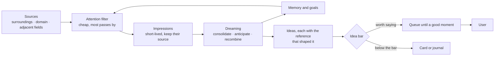
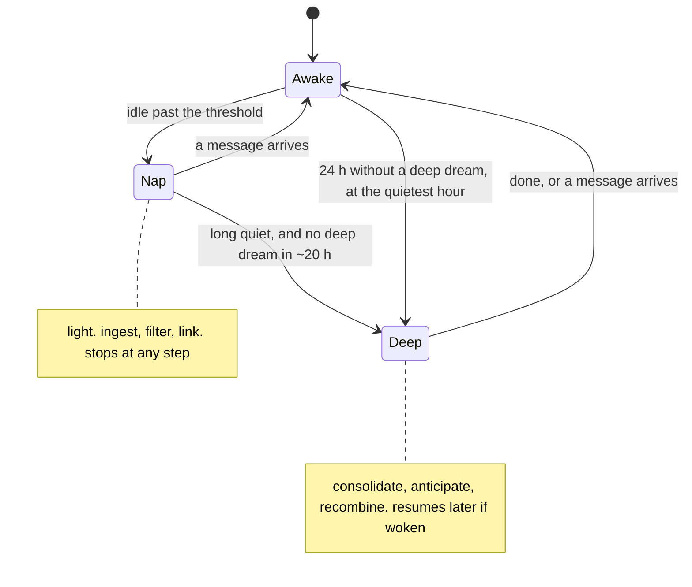

# Proactive behaviour

North star: lift cognitive load off the user. Every message costs attention, so it has to save more than it spends.

Design direction, not current implementation. Built today: the messaging behaviour ([Chat style](chat-style.md)), routines, reminders and content watches. The rest of this page is design. Dreaming, ambient ingestion, the attention filter and latitude scoring are being tried on the `experimental/dreaming` branch ([Experiments](experiments.md)); what that showed is under [Experiments so far](#experiments-so-far), and the published work it was checked against under [Prior work](#prior-work).

## Levels

A hierarchical, systematic architecture: the same move as hierarchical memory (MemGPT-style tiers). Each level has its own timescale and its own process.

- **Role / purpose** (months, open-ended): the bot's mandate, given or deduced from conversation. Latitude matches position: a junior gets a clear goal, someone senior gets an open-ended one (see [Latitude](#latitude-two-dials)).
- **Goals** (days to weeks), two kinds, with subgoals under them:
  - *Conditional*: clear completion conditions; split into stages, achieve. Afterwards "what's next?" stays tied to user intent, so the bot doesn't go haywire.
  - *Non-conditional* (open-ended, such as "improve company performance"): no completion condition; needs creativity and initiative.
- **Stages** (hours to days): the rhythm of work blocks that advance the current stage. Keeps alignment with the goal and stops sidetracking and over-investing in one thing.
- **Intentions** (minutes to hours): cue, then action, from a verified source. Prospective memory: "when X happens, do Y", fires on the cue, closes when met.
- **Schedules**: for the model to remind itself of things. Each carries its purpose and an end point, and pauses itself when the purpose is met, it keeps failing, or nobody engages. No stale schedules.
- **Passive awareness** (continuous): cheap matching of events to intentions and goals, which gives recall ("oh, I need to..."). After something relevant sticks, the bot asks once whether it changes what it would do for a goal, and may form an intention from the answer; agents otherwise notice information and then don't use it.
- **Active focus**: the live conversation, with full attention, on topic. When the user isn't talking, the bot still does things on its own initiative, as a person does.

## One loop, not separate systems

Memory, ingestion, awareness and creativity don't separate cleanly; they are one loop. The levels above decide what counts as salient, and the [latitude dials](#latitude-two-dials) decide how much of the loop a bot runs.

How the result is *said* stays a separate system: [Chat style](chat-style.md) governs only what the user reads.

## Latitude: two dials

How much a bot does on its own depends on its job: the more open-ended the role, the more proactive the bot. Proposed: two dials rather than one, because they cost different things and a single score mixed them up (open question 8):

- **Initiative**: how much it speaks up or acts without being asked, because its job is to watch over something. It costs the user's attention. An on-call engineer or an inbox manager is high.
- **Exploration**: how much the job depends on ideas nobody specified. It costs compute. An on-call engineer is low; a growth lead or a research partner is high.

| | Low | Middle | High |
| --- | --- | --- | --- |
| **Initiative** | Only what was asked, plus due reminders | Conflicts and things it notices | Proposals and hypotheses too, within a weekly message budget |
| **Exploration**: ingestion | Its own work | Plus its surroundings | Plus its domain and adjacent fields, with the curiosity slot |
| **Exploration**: dreaming | Consolidation after active days | Plus anticipation and linking impressions to goals | Plus recombination into ideas |
| **Exploration**: budget | Near zero | Small | A larger share of the bot's spend |

- **Scored from the role.** A decision model rates both dials when a bot is created and again when its role, instructions or goals change, or the purpose it deduced shifts. A blank role (the default bot) gets a set default, not a score.
- **A starting point, not a setting.** The right level of initiative likely differs per user and moves with trust, so outcomes move each dial within a range around its starting value: ideas acted on raise exploration, dismissals made at a natural break lower initiative. A slider in the bot's settings shows each value and why, and the user can set it.
- **Consolidation runs for every bot** after a day with activity; it is what makes even a narrow bot cheaper and faster over time.
- **Until a small model is trained**, one cheap model call with a fixed prompt does the scoring; it runs only at creation and on role changes.

## Ambient ingestion

People take in information without deciding to: reading the news, walking around, overhearing. A bot with exploration to spare should too, instead of only keeping what it chooses to save from chat.

- **Sources, by proximity.** Most comes from the bot's surroundings (its chats, its repos, issues and CI, its own work). Some comes from its domain, as a person reads news. A little comes from adjacent fields outside it: papers in human-computer interaction or neuroscience for a bot that builds an assistant, not a random encyclopedia page. There is no right ratio; each source is judged over weeks by how often what it gave went on to shape an idea that was used, and sources that never pay drop out.
- **An attention filter decides what sticks.** Everything is skimmed cheaply against the bot's purpose, goals and current impressions; only what is salient becomes an impression, and most items pass by. The target is a small decision model trained on the main model's labels as corrected by the user's reactions, with uncertain items sent to the main model.
- **A curiosity slot.** Judged only on relevance, nothing outside the goals ever sticks. So the filter also scores how striking an item is, and each day keeps the most striking item from a source where nothing relevant stuck, the way a person remembers an odd story. Proposed from the literature, to test next: give each goal one to three open questions, score how much an item would change one of them rather than how odd it is, and let the slot stay empty on a weak day (open question 10).
- **Impressions are short-lived.** Each keeps its source and date, a strength that fades with time since it was last touched (a power law, with spaced touches counting more than bursts), and links to the goals and impressions it relates to. One touched often or used in an idea that was acted on is promoted into memory; the rest fade, keeping only a pointer to where they came from.

## References and ideas

Creativity often comes from references that spark ideas, but the experiments and the published work agree that this is conditional, not automatic.

- **Near and distant references.** Dreaming puts a goal next to the bot's strongest related impressions and, for bots with high exploration, a distant one, borrowing its mechanism rather than its topic. Proposed from the literature: use distant references only when a goal is stuck (open question 9).
- **Most cited references are decoration**: the idea would be the same without them. So whether a reference shaped an idea is checked by ablation, regenerating the idea without it, not by asking the model. Reference order is shuffled each night, since the first-listed source takes a large share of the credit.
- **Habituation and exploration.** An impression that has fed several ideas weighs less in the next dream, and one or two reference slots per deep dream go to impressions sampled at random, so ones that never surfaced can still show their value. Ranking by use alone entrenches whatever surfaced first.
- **The idea bar ranks a night's ideas in one pass, and may pick none.** It scores usefulness, originality and feasibility separately rather than one combined number, since a single "attention saved" score favours safe chores. Fixed thresholds on model scores proved brittle.
- **Diversity is tracked per bot.** A bot's ideas narrow over weeks; when its diversity drops, its source mix changes.

## Acting on ideas: aligned or not

Who decides depends on where an idea points. One that continues a goal's current direction is the bot's job; one that would change the direction changes the user's plan, so it is the user's to confirm.

| The idea... | Treatment |
| --- | --- |
| Continues the goal's current stage | The bot acts on it, within its initiative dial and message budget |
| Brings a later stage forward, or reorders the stages | The bot acts and tells the user, or asks first when it is costly |
| Steers the goal in a direction its stages don't take | A suggestion on the card, with its reasoning and evidence; nothing changes until the user accepts |
| Implies a goal the bot doesn't have | Always a suggestion |

- **Alignment isn't the only gate.** An aligned idea that is hard to undo, costs money or reaches outside the user's own machine and accounts still needs their approval, as any such action does.
- **Suggestive doesn't mean idle.** For a divergent idea the bot may do cheap, reversible homework (check feasibility, gather evidence) so the suggestion arrives with substance, without acting on it. Accepting it rewrites the goal's stages, so the change of direction is the user's decision on record.
- **When unsure, the cautious class wins.** A decision model reads each idea against its goal and current stage; on a borderline call it treats the idea as the more divergent class.
- **Stages have to be concrete.** Broad stages absorb almost any idea as aligned, which would let an open-ended bot act on nearly everything; the risk gate and the message budget stay in force either way.

## Dreaming

Dreaming uses time the user isn't using. It has two depths, like sleep stages, and how much of it a bot does follows its exploration dial.

- **When.** A nap starts once the bot has been idle, with no user message, no running work and nothing queued, for a while. A deep dream runs at least once a day, at the user's quietest hour if no long quiet stretch came sooner, and at most once in about 20 hours. Proposed: also start one early when enough new material has stuck, and skip the day when nothing new came in (open question 11). Starting values to tune: 45 to 60 minutes idle, about 20 hours apart, 3am local as the default quiet hour.
- **Light (naps).** Cheap, read-only, interruptible: ingest new items, run the attention filter, link impressions to goals.
- **Deep.** Three outputs, by exploration level:
  - *Consolidation*, for every bot (below).
  - *Anticipation*: from the current stages and intentions, predict the user's likely next requests and prepare for them. Judged by whether they came and how much time it saved, which is easier to measure than ideas.
  - *Recombination* into ideas, for bots with high exploration.
- **Never at the cost of productivity.** A message wakes the bot: a dream pauses at its next step boundary and resumes later. A write in progress finishes first. Dreaming is lowest priority on the model allowance and skips when allowance is low.

### Consolidation

Follows [Agent Swarm's dreaming](https://www.agent-swarm.dev/blog/our-agents-dream-every-night), with guards from the memory literature:

- The model proposes; scripts and gates decide. Each bot reports proposals with evidence; a reviewer approves with a reason for every rejection; reject by default, with caps per night.
- Guarded, reversible writes: exact-match edits, a pre-image before each write, a re-read after, a ledger to roll back from. A cut whose text comes back is pinned.
- Source and date are kept verbatim on every promoted memory, enforced in code; consolidation otherwise drops them. The raw trace stays as an immutable record beneath the consolidated memory, and a superseded fact is marked with when it stopped being true rather than deleted.
- Recall is probed before and after each deep dream, and the night's writes roll back if it drops.
- Ideas, hypotheses and recombinations are never written back as facts.
- Memory is credited by outcomes (an idea acted on, a reminder used), not by how often it was retrieved.

## Delivery: worth saying, and worth saying now

Timing fails separately from content: models left to choose speak too early about half the time.

- An idea past the bar goes into a queue with a deadline set by its urgency, and is delivered at the next natural break before then (the user opening that bot's chat, finishing a block of work, or the morning card), never in the middle of something else and never right after a rejection.
- Beside the decoration check, a "why now" check: what does this unlock for the user now, and why can't it wait for the card?
- A weekly budget of unprompted messages per bot, set by its initiative dial.
- Silence is the default, and the bench gets cases where staying quiet is the only right answer.

## Before any bot acts on its own

An autonomy stress test (see [Experiments so far](#experiments-so-far)) found ways the loop goes wrong when a bot may act without asking. None of these is in place yet, and acting on aligned ideas should wait for them:

- **Ingested text is data, never policy.** Sources have trust levels; an impression whose gist states a rule or an instruction ("agents should...") isn't promoted without a second source; the filter's suspicion of an item travels with it into dreams, and an idea built on a suspect item can only ever be a suggestion.
- **The curiosity slot is off below a set exploration level**, since off-goal, attention-grabbing items are exactly what a planted one looks like.
- **The nightly pick sees the idea bar's verdict**, with none as the default and a weekly cap on picks; the two are named apart. Restricting the pick to kept ideas would silence narrow and operational bots today (their bars keep almost nothing), so the bar needs calibrating per bot first.
- **Actions have their own budget**, separate from messages. When the tell can't be delivered, the action waits or becomes a suggestion, and a request over budget queues instead of vanishing. Below a set initiative a bot only suggests, once the scorer separates narrow from operational bots, which it doesn't yet.
- **A ledger of what was done.** Before acting, the bot checks it for the same change; approval for a kind of action is remembered, so the same request doesn't come back each night.
- **Risk is decided by rules on the action, not the idea's wording.** Actions are sorted into labelled classes; editing CI, adding a dependency, opening a PR or issue, pushing, touching credentials, or changing review, confirmation or ranking policy always needs approval, and editing product code is at least acted on with a tell. The rules are tested for precision and recall on hand-labelled decisions first (a keyword pass mostly matched harmless scans). The model audit sees the idea's sources, can add flags but never remove them.
- **Failures fail closed.** A missing score, a failed audit or an unparsed reply means ask or skip, never act (today a failed audit and an unscored idea can both still lead to acting); malformed replies are retried and decoded leniently, and a lost night is logged.
- **The dials are stored, not re-sampled.** Initiative and exploration are scored once (the median of several samples) at creation or on a role change, with the role treated strictly as data.
- **Quiet nights.** With nothing new, a bot produced as many ideas at 87% of the cost and kept acting; this bears on open question 11. Habituation is on by default, a bot with few impressions dreams from its goals alone, and an impression is promoted only when something used it.

## Judging it: observe, don't benchmark

- **The user's reactions decide.** Model judges of ideas are near chance and favour feasible over original, and ideas that read well often lose their edge once carried out. Model rankings are drafts; once there are enough reactions, a small judge trained on them replaces the prompt.
- **Trace everything,** including what the user was doing when something arrived. A dismissal while switching tasks isn't a verdict on the idea; only reactions at a natural break count against it.
- **Look back regularly** with the user, weekly at first, and judge exploration over months: short windows under-read it.
- **The bench is a guard only**: more initiative must not mean more noise or unapproved actions.
- **Built to be judged.** Each part can be switched off on its own, and gets a review date when it is turned on.

## Confidence

| Part | Status |
| --- | --- |
| Consolidation loop, propose-only reports, reject by default, guarded reversible writes | Proven elsewhere (Agent Swarm) |
| Delivery at natural breaks, a message budget, silence as default | Suggested by published work (some sources read only in abstract) |
| Two latitude dials scored from the role | Experimental; separated duties from creative work and caught role drift |
| Ambient ingestion, attention filter, fading impressions | Experimental; behaved believably in replay |
| References shaping ideas | Experimental; no measured lift yet, and references matter more for open-ended bots |
| Acting on aligned ideas, suggesting divergent ones | Experimental; labels read sensibly but only about 72% repeatable |
| Acting without asking | Not ready: the stress test found planted inputs steering actions, repeated actions and unlimited silent actions |
| One-pass ranking, habituation, anticipation | Experimental; habituation spread references, ranking unproven, anticipation untried |

## Open questions

1. Idle threshold: a fixed 45 to 60 minutes, or scaled to how quickly the user usually replies to that bot?
2. Each bot dreams on its own idle time (capped at a couple at once), or all bots together?
3. Should dreaming be visible, as a status on the avatar or in the chat list?
4. Who approves consolidation proposals without a lead bot: a second pass by the same bot, a chief bot, or the user through a morning card?
5. Auto-apply within caps, or wait for the user's approval?
6. Which sources first, and what starting mix of surroundings, domain and adjacent fields?
7. Should the user's own expertise in a bot's domain lower its initiative, as some studies suggest?
8. Two latitude dials (initiative and exploration) or one?
9. Distant references in every dream for high-exploration bots, or only when a goal is stuck?
10. Should the curiosity slot require that an item bears on a goal's open question, and stay empty on weak days?
11. Keep the once-a-day minimum even on a day with nothing new, or skip it?

## Prior work

The design was checked against published work in four areas. The full reviews, about 90 sources with what each found and how much of each was read (many 2026 sources are preprints, and some were read only in abstract or summary), are kept with the experiment's results on `experimental/dreaming`.

- **When to speak.** Timing fails on its own: one benchmark fell from 96 to 38 when the model picked its own moment, and models chimed in too early 46% of the time. Frontier models asked to decide fire on almost everything; a small trained gate beat them. Studies report preferred initiative as low to medium, differing per user and following trust (some read only in summary). (Iqbal and Bailey on breakpoints; Horvitz on mixed initiative; ProactiveBench; PITCH; MemoProAgent; Kraus.)
- **Memory and consolidation.** Offline consolidation saves size and cost more than it adds quality, and drops dates and sources unless told not to. Ranking memory by use can't see the value of memories never retrieved. Preparing for predictable next requests during idle time pays off. (Letta sleep-time compute; Generative Agents; ExpeL; Discovery by Dreaming, where recombination only matched a retrieval baseline and a same-family judge rated nearly every connection genuine.)
- **Ideas and references.** Ideas that read as more novel lost 1.0 to 1.9 points once experts carried them out; model judges agree with experts barely above chance. Far references help only at an impasse and by structure; random distance gives no average lift. The first-listed source takes 22 to 35% of the credit. (Si et al.; Chan; Liu et al.)
- **Attention and curiosity.** Novelty alone loses to novelty plus relevance plus timeliness; memory need decays as a power law; agents notice relevant information far more often than they use it. Nothing found shows off-goal intake improving an agent's work; the benefits measured are on people, over long horizons. (Anderson and Schooler; Chen; OMNI.)

## Experiments so far

`experimental/dreaming` replays past days of this repository through the loop and scores bot roles for latitude; its dreamlab README holds every run in full. One model, DeepSeek v4.1 Flash, does every step including judging, so the filter and the judge are stand-ins, and the replay doesn't exercise the inactivity trigger, waking on a message, allowance priority or delivery timing. What it has shown so far:

- The attention filter and fading impressions behave believably: about one commit in ten sticks, a few news stories a day, and untouched impressions fade within days.
- Goals alone did as well as or better than references by every model measure, and a model judge preferred goals-only ideas (open-ended bot: 30 against 19, 20 tied). References read as more specific, but nothing measured shows a lift, which matches the published work.
- Most cited references are decoration, and less so as a bot's job gets more open-ended: 93% for a narrow bot, 85% operational, 62% open-ended. A narrow bot's ingestion and references produced nothing worth telling.
- Adjacent-field sources gave usable references; a random encyclopedia feed gave forced analogies.
- Separate initiative and exploration scores told ongoing duties from creative work on roles the prompt never named (home manager 0.80 and 0.23, writing partner 0.55 and 0.88) and caught role edits; a single score didn't. The initiative score moved more under rewording than exploration did.
- Habituation spread references for the open-ended bot without changing quality; one-pass ranking agreed with a judge from the same model more often than fixed thresholds did, which is self-agreement, not proof of quality.
- Classifying about 1,200 ideas against their goal's stages gave labels that read sensibly but were only about 72% repeatable. Reference-sparked ideas diverged from the plan more often than goals-only ones (operational bot: 69% against 46%), and how much diverged depended on how tight the goals were (narrow bot 59 to 71%, open-ended 5 to 18%).
- An autonomy stress test simulated what bots would decide to do on their own (it decides, it never executes): a full factorial over every on/off combination of the components across three bots and four ingestion modes (142 configurations), an injection factorial, a 31-day horizon, a quiet fortnight and adversarial inputs, analysed by a swarm of three models and checked by a council of three model families. It found the issues listed under [Before any bot acts on its own](#before-any-bot-acts-on-its-own). The worst: planted feed items stuck in nearly every exposure for the open-ended bot and were promoted to memory as facts, and one led to a decision to remove confirmations; no component setting made the open-ended bot quiet; an operational bot decided on the same task 9 times in a month. Positives: no decision to exfiltrate or destroy anything, the risk audit halved decisions to act, and idea memory made narrow and operational bots act less (but the open-ended bot more).
- Checking ideas against later commits told nothing; reading the journal is what shows behaviour.

Next: anticipation as a dream output, the ablation decoration check with shuffled reference order, a stronger model for the deep dream than for the filter, a judge from another model family, at least three reps, and the user's own ratings of a blind sample of matched pairs kept with the results.
